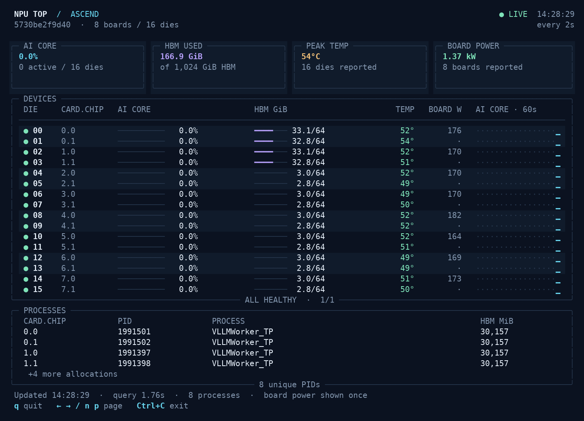

# npu-top

A read-only terminal dashboard for Huawei Ascend NPUs. It reads `npu-smi info` and shows AI Core utilization, memory, temperature, board power, processes, and 60 seconds of utilization history.

[中文说明](README.zh-CN.md)



## Install and run

Use Linux with Python 3.10 or newer and an installed Ascend driver. Confirm that `npu-smi info` works first.

```bash
git clone https://github.com/demouo/npu-top.git
cd npu-top
python3 -m venv .venv
.venv/bin/python -m pip install .
.venv/bin/npu-top --doctor
.venv/bin/npu-top
```

The only Python dependency is Rich. PyTorch, torch_npu, CANN's Python packages, and training frameworks are not required.

Press `q` or `Ctrl+C` to quit. Use the left and right arrow keys, `n`, or `p` to change pages. The dashboard adapts to the number of visible devices and the terminal size.

## Compatibility

| Environment | Verification |
| --- | --- |
| Ascend 910C, 8 boards and 16 dies, aarch64 Linux, npu-smi 25.5.2 | Tested on hardware |
| Other Ascend 910, 910B, or 910C machines with the same table layout | Expected to work; not tested on those machines |
| Single-chip layouts with a `Memory-Usage(MB)` field, including layouts used by 310-series devices | Tested with synthetic fixtures; no 310 hardware test |
| Linux x86_64 | No architecture-specific code; no hardware test |
| Windows, macOS, or drivers with different output layouts | Unsupported |

Compatibility depends on the driver's output format. The parser expects the three-column device table with `NPU Name`, `Chip Phy-ID`, and `AICore(%)` rows. It selects `HBM-Usage(MB)` when present, otherwise `Memory-Usage(MB)` or `DDR-Usage(MB)`. Missing values remain unavailable. A missing process table is reported as unavailable.

The program discovers board, chip, and physical IDs from the table. It does not assume eight cards, two chips per card, consecutive IDs, or a particular memory capacity. Board power is counted once per board.

In containers, the driver executable, driver libraries, and permitted NPU devices must be accessible. The dashboard shows what `npu-smi` can see. It does not filter devices according to `ASCEND_RT_VISIBLE_DEVICES`.

## Commands

| Command | Result |
| --- | --- |
| `npu-top` | Refresh every 2 seconds |
| `npu-top -i 1` | Refresh every second; minimum interval is 0.5 seconds |
| `npu-top --once --no-color` | Print one dashboard snapshot |
| `npu-top --json` | Print one snapshot as JSON; missing measurements are `null` |
| `npu-top --doctor` | Check executable discovery, driver access, and table parsing |
| `npu-top --npu-smi /path/to/npu-smi` | Use a specific driver executable |
| `npu-top --version` | Print the version |

You can also set `NPU_SMI=/path/to/npu-smi`. Without an override, the program searches `PATH`, then `/usr/local/Ascend/driver/tools/npu-smi`.

When input or output is redirected, `npu-top` prints one snapshot and exits. Each driver query has a 10-second deadline. Interactive mode retries failed queries and marks the last successful sample as stale.

## Troubleshoot

Run `npu-top --doctor`. If the driver is missing, pass its location with `--npu-smi`. If access fails, run `npu-smi info` in the same environment and check the driver installation and device permissions.

If parsing fails, open an issue with your NPU model, driver version, and a sanitized copy of `npu-smi info`. Remove hostnames, process names, and PIDs that you do not want to publish.

## Development

Run the fixture and CLI tests without NPU hardware:

```bash
python3 -m pip install .
python3 -m unittest discover -s tests -v
```

The fixtures cover multiple dies, nonconsecutive IDs, memory-only layouts, unavailable metrics, and process tables. CLI tests exercise JSON output, driver failures, and query timeouts. Hardware verification is separate from these tests.

## License

Apache-2.0. The Ascend driver and `npu-smi` are supplied separately by Huawei.
