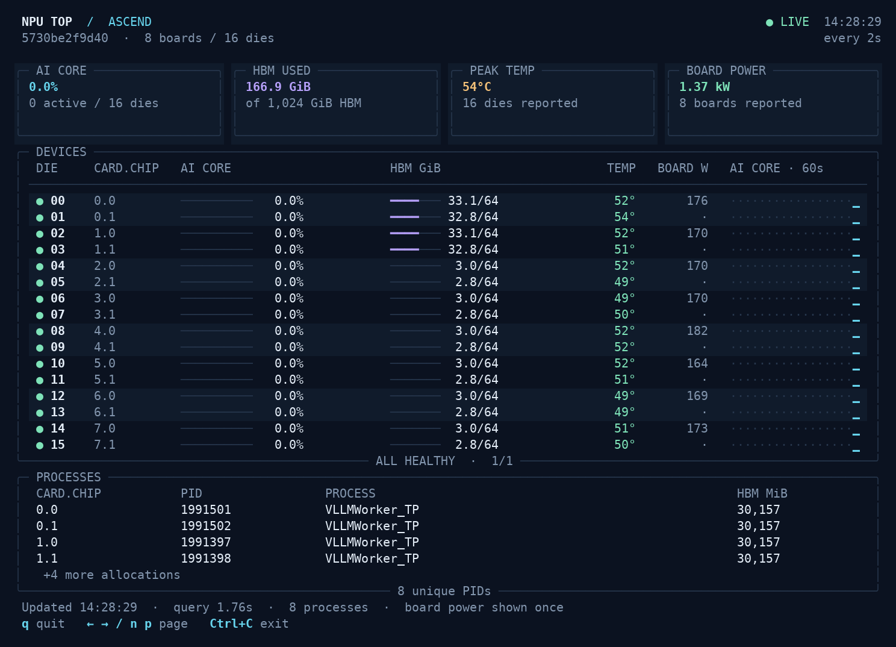

# npu-top

昇腾 NPU 终端监控工具。只读调用 `npu-smi info`，显示 AI Core 利用率、内存、温度、板卡功耗、进程及最近 60 秒的利用率变化。

[English](README.md)



## 安装与运行

需要 Linux、Python 3.10 以上及昇腾驱动。先确认 `npu-smi info` 能正常运行。

```bash
git clone https://github.com/demouo/npu-top.git
cd npu-top
python3 -m venv .venv
.venv/bin/python -m pip install .
.venv/bin/npu-top --doctor
.venv/bin/npu-top
```

Python 依赖只有 Rich，不需要 PyTorch、torch_npu 或训练框架。按 `q` 或 `Ctrl+C` 退出，方向键左右或 `n`、`p` 翻页。

## 其他昇腾机器能否使用

程序不固定卡数、每卡芯片数、物理编号或内存容量。只要目标机器的 `npu-smi info` 输出符合支持的表格格式，就可以运行。

| 环境 | 验证情况 |
| --- | --- |
| Ascend 910C，8 卡 16 die，aarch64 Linux，npu-smi 25.5.2 | 已在真实硬件运行 |
| 相同表格格式的其他 910、910B、910C 机器 | 预期可用，未逐机型实测 |
| 单芯片、仅有 `Memory-Usage(MB)` 的布局，包括 310 系列使用的同类布局 | 合成样例测试通过，没有 310 硬件实测 |
| Linux x86_64 | 无架构专用代码，没有该架构的硬件实测 |
| Windows、macOS 或其他输出格式 | 不支持 |

解析器要求三列设备表，包含 `NPU Name`、`Chip Phy-ID` 和 `AICore(%)` 行。内存优先读取 `HBM-Usage(MB)`，否则读取 `Memory-Usage(MB)` 或 `DDR-Usage(MB)`。缺失指标显示为不可用，不记成 0；驱动没有返回进程表时，明确显示进程信息不可用。功耗按板卡去重。

容器内需要能访问驱动命令、驱动库及获准使用的设备。显示范围以 `npu-smi` 实际可见设备为准，不按 `ASCEND_RT_VISIBLE_DEVICES` 过滤。

## 常用命令

```bash
npu-top --doctor
npu-top -i 1
npu-top --once --no-color
npu-top --json
npu-top --npu-smi /usr/local/Ascend/driver/tools/npu-smi
```

默认每 2 秒查询一次，最短间隔 0.5 秒。也可通过 `NPU_SMI` 指定命令路径。未指定时先查找 `PATH`，再查找驱动标准目录。

重定向输入或输出时只打印一次快照。每次驱动查询最多等待 10 秒，交互模式在失败后重试并标出旧数据。`--json` 的缺失指标为 `null`。

如果 `--doctor` 失败，先在相同环境运行 `npu-smi info`，检查驱动与设备权限。输出格式不兼容时，可在 issue 中提供机型、驱动版本和脱敏后的输出。

测试命令与完整参数见 [English README](README.md)。源码采用 Apache-2.0 许可证，昇腾驱动及 `npu-smi` 由华为另行提供。
